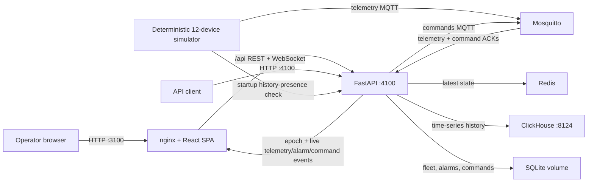

# Architecture

Aeris Control is a six-service local system. The browser talks only to nginx in the normal operator path; nginx serves the built SPA and proxies both REST and WebSocket traffic to FastAPI. The API remains published separately for inspection and integrations.

## Startup and persistence

Compose health dependencies establish a deterministic order: Redis, ClickHouse, and Mosquitto become healthy; the backend applies versioned SQLite and ClickHouse migrations, reconciles the fleet, and resumes any incomplete durable telemetry inbox records; only then may the simulator publish. On a fresh installation the simulator finds no recent AHU-204 history and publishes 12 five-minute points from the preceding hour, excluding the live-start timestamp. On ordinary restart it finds persisted recent history through the backend API and skips that bootstrap. Web starts after backend health is `ok`. Restart policies and named volumes preserve state across normal stop/start cycles.

The seeded fleet is `AHU-201` through `AHU-212`. `AHU-204` deterministically publishes pressure above the 7.5 bar rule, creating the demo alarm through the same MQTT ingestion path used by every other sample. Commands take the reverse path and return through `devices/{id}/command-acks`; no production code path is mocked.

## Storage responsibilities

| Store | Responsibility | Persistence |
| --- | --- | --- |
| SQLite | equipment registry, alarms, command lifecycle, per-device telemetry cursor, durable ingestion inbox, migration ledger | `backend_data` volume |
| Redis | latest connected device state | AOF in `redis_data` volume |
| ClickHouse | ordered telemetry history | `clickhouse_data` volume |
| Mosquitto | MQTT transport | `mosquitto_data` volume |

SQLite and ClickHouse each keep a deterministic migration ledger. The upgrade migration preserves the original telemetry table, copies legacy history into an event-keyed `ReplacingMergeTree`, and makes replayed QoS 1 inserts logically idempotent. Fresh-install and legacy-volume upgrade paths are covered independently. Fleet seed reconciliation is also idempotent. The explicitly scoped reset command is the only supported destructive local operation.

## Telemetry processing contract

MQTT telemetry is accepted only on the exact `devices/{id}/telemetry` topic when the payload device matches, the timestamp is within configured age/skew limits, and every measurement is finite and within its physical domain. Runtime MQTT health becomes ready only after the broker acknowledges the telemetry/command-ack subscriptions and resets on disconnect. A canonical SHA-256 event key is recorded in SQLite before side effects. ClickHouse history is written idempotently, then a transactional per-device timestamp cursor decides whether the sample may update the alarm lifecycle and Redis current state. An older sample therefore remains historical only; it cannot open, close, or roll back an operational alarm. The MQTT PUBACK is sent only after processing completes. If a dependency fails or the process exits, the persistent MQTT session and SQLite inbox make the event retryable, and startup recovery resumes incomplete work.

The pressure rule opens at exactly `7.5 bar`. `ACTIVE` and `ACKNOWLEDGED` are both unresolved operational alarms; recovery closes the alarm, and a later threshold breach opens a new lifecycle.

## API and realtime bounds

Equipment status is computed server-side as `RUNNING`, `OFFLINE`, `STALE`, or `NO_DATA`; connected telemetry becomes stale after the configured age. Detail history accepts at most the configured span (seven days by default) and asks ClickHouse to bucket and return no more than the configured point budget (600 by default), including the 1H/6H/24H/7D UI ranges.

The WebSocket begins with a session epoch and sequence, then carries telemetry, alarm, and command events. One app-level provider updates every relevant TanStack Query cache. A changed epoch clears local ordering state, and every connection reconciles authoritative REST data. Reconnect retries continue indefinitely with a five-second maximum delay, so backend restarts and extended outages do not freeze the UI. The pressure chart keeps a stable history request while its visible right edge follows current time or the newest valid live point.

## Reliability and observability

- Each long-lived service has a meaningful health check; backend health includes all runtime dependencies, and simulator health requires a recent publish heartbeat.
- FastAPI lifespan shutdown stops the expiry worker and MQTT network loop, then closes Redis and ClickHouse clients. The simulator handles `SIGTERM`, disconnects MQTT, and removes its heartbeat.
- API and simulator application logs are structured JSON. nginx assigns a request ID, forwards it as `X-Correlation-ID`, and FastAPI returns/logs it.
- The WebSocket sends an epoch, latest-value snapshot, and then monotonic live messages. nginx keeps upgrade connections open and SPA fallback serves deep links.
- Health exposes dependency state plus structured telemetry/ACK acceptance, duplication, failure, and rejection counters.
- Web `3100`, API `4100`, and ClickHouse HTTP `8124` bind only to host loopback. Redis and MQTT are internal. Remote deployment is outside the local-demo threat model and requires authentication, TLS, protected credentials, and network access controls.
